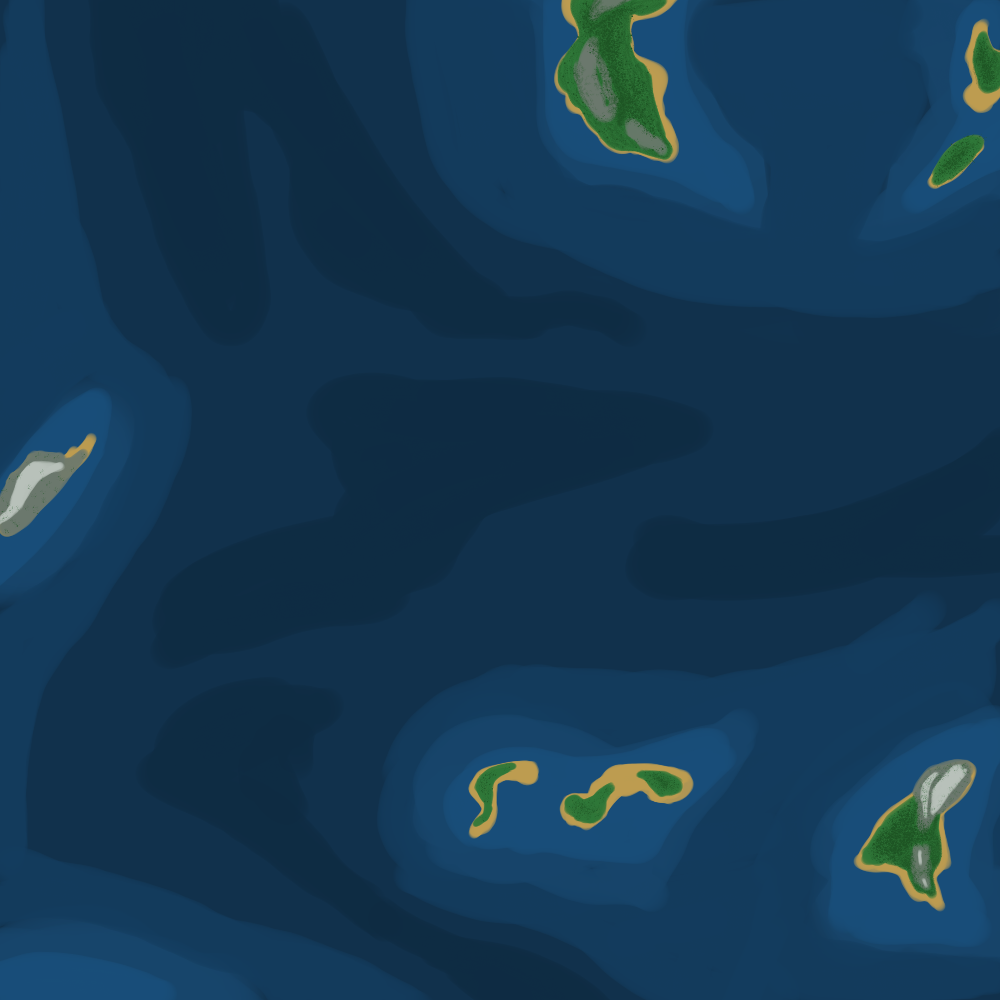
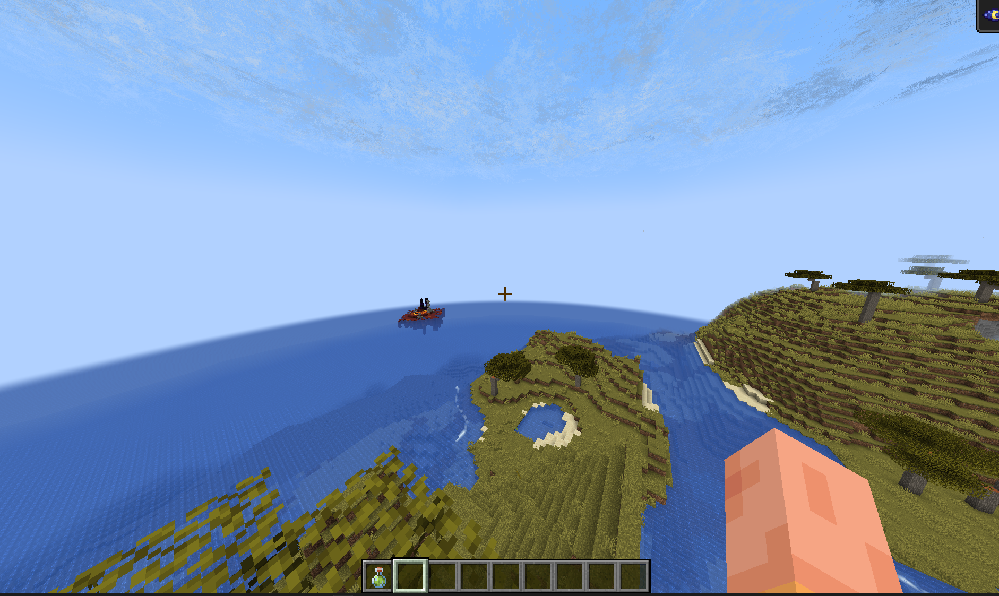
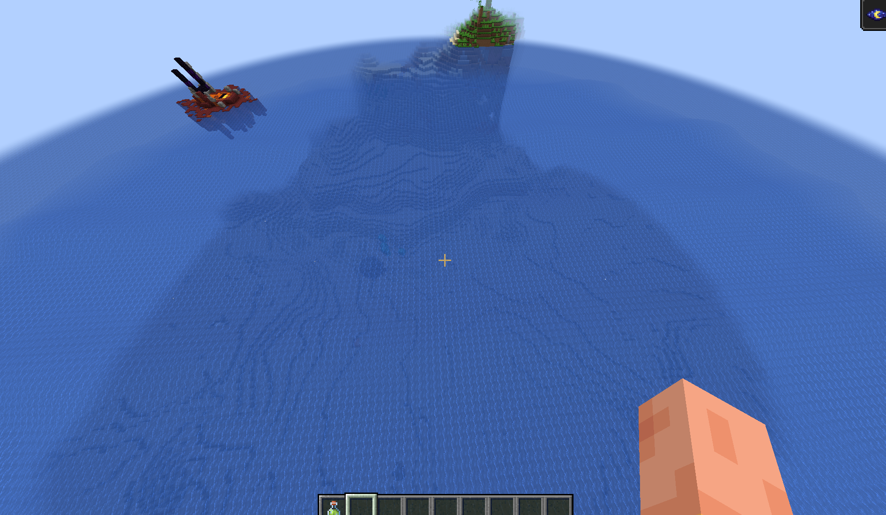
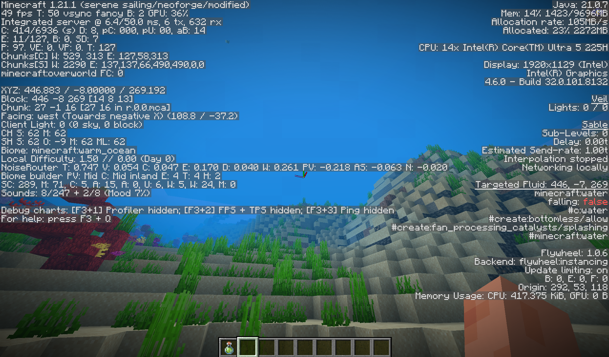

# Serene Ocean Worldgen

Serene Ocean Worldgen is a Minecraft world generation mod built for seafaring and ocean survival. It transforms the Overworld into an endless ocean filled with scattered island archipelagos and deep underwater trenches.

## Features

- **Endless Ocean World**: Vast open water designed for sailing and maritime exploration.
- **Deep Trenches**: Dramatic abyssal depths plunging far below standard vanilla oceans.
- **Island Archipelagos**: Isolated islands and island clusters scattered across the sea for you to discover and settle.
- **Guaranteed Island Spawn**: Spawns you safely on a land island with sheep for starter wool and food, so you never start stranded in deep water.
- **Smooth World Creation**: Pre-configured world preset that loads cleanly without experimental warning popups.

## Screenshots

## How to Use

1. Click **Create New World**.
2. Go to the **World** tab.
3. Set **World Type** to **Serene Sailing - Endless Ocean**.
4. Click **Create New World** and begin your journey.

## Requirements

- Minecraft: 1.21.1
- Mod Loader: NeoForge

